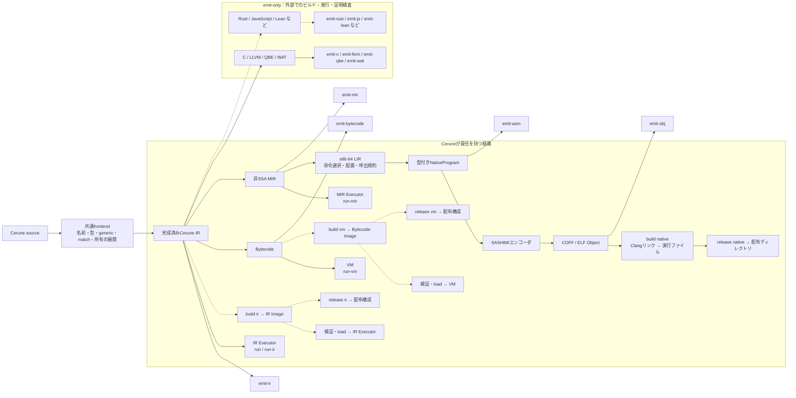

# 実行経路とbuild / releaseの責務

[English](owned-routes.en.md) · [Issue #81](https://github.com/Cerune-Lang/Cerune/issues/81)

## 方針と現状

Ceruneが完成成果物と実行契約を定義する経路はIR・VM・Nativeの3つです。
`build`はその経路で利用できる完成成果物を作り、`release`は配布向けに構成します。
実行方式や暗黙の最適化を選ぶ操作ではありません。

現行実装には`run`／`run-ir`、`run-mir`、`run-vm`、各`emit-*`と、[観測bundleを保存する`observe`](observation-bundle.ja.md)があります。
**[Native build](native-build.ja.md)と[Native release](native-release.ja.md)は実装済みです。IR/VMのbuild・release、Imageの保存・読み込み、Lean backendは未実装です。**
以下の図の破線は計画を示します。言語機能の対応状況は経路ごとに別途管理します。
動的配列はIR・MIR・VM・C・LLVM・QBE・WAT・Windows/Linux ASM・自前Objectで対応済みです。[IR段階設計](ir-stages.ja.md)のMIR生成・独立実行は実装済みです。これは新しいbuild／releaseの配布routeを確定するものではありません。

## Issue #81の提案と現在の区別

以下は責務と各操作の実装状況です。

| 操作 | 役割・状態 |
| --- | --- |
| `run`／`run-ir`、`run-mir`（`--ssa`含む）、`run-vm` | 実装済み。選んだ表現を独立した実行器で評価 |
| `emit-*`／`observe` | 実装済み。表現を生成・保存。observe自身は実行しない |
| `show` | 未実装の案。Ceruneの意味を人間向けの別表記で表示。実際のRust等の生成とは別 |
| `run --via` | 未実装の案。追加backendと外部ツールで実行。ツール欠落・生成失敗・build失敗・起動失敗・timeout・言語上の停止を区別 |
| `build native` | 実装済み。明示target・Clangで実行ファイルと生成・リンク記録を構築 |
| `release native` | 実装済み。成功済みbuildを直接runtime要求・SHA-256とともに配布ディレクトリへ保存 |
| IR/VMの`build`・`release` | 未実装。Image・配布契約を別途設計 |

ownedかどうかは外部ツールの有無ではなく、成立条件・成果物・互換性・失敗・実行をCeruneがどこまで管理するかで判断します。**owned・実装済み・この環境で利用可能・指定targetへbuild可能・ここで実行可能は別の状態です。** routeと成果物種別も分けます。

Parsing（読み方）、Semantics（意味）、Realization（意味の具体化）、Execution（実行環境との接続）は責務の区分であり、必ず一度ずつ通る固定工程ではありません。追加backendでも生成結果が共通の意味を守る責任は残ります。Web UIへの接続だけを理由にJavaScript backendを必須にはせず、ホスト接続／WASMとの関係から判断します。

## 経路図

実行とImage構築は分岐します。buildのためにプログラムを実行しません。
型付きNativeProgramからAssembly表示とObjectを生成します。Assemblyテキストを再解析せず、外部アセンブラも必須にしません。

## 操作と完成成果物

| 操作 | 契約 |
| --- | --- |
| `emit-*` | 特定段階の表現を明示的に取り出す。観測・後続処理の入力であり、完成品とは限らない |
| `build ir` / `build vm`（計画） | 形式・意味の版、実行入口、必要な定義、資源契約、出自を持つ、load可能なImageを構築 |
| `build native` | 明示target・Clangで実行ファイルを構築し、生成過程とリンク記録を保存。[契約](native-build.ja.md) |
| `release native` | 成功済みbuild、直接runtime要求、SHA-256、実行案内を保存。システムライブラリは対象環境へ要求 |
| IR/VMの`release`（計画） | 各Imageとruntime・互換条件を配布可能に構成 |

生成処理の共有は可能です。ただし、テキスト`.ceir`／`.cebc`やObjectに別名を付けただけでbuildとはしません。
現行のテキスト観測形式を、そのまま安定した入力形式と約束しません。
Imageの拡張子・コンテナ形式・互換性の版付けは、loader設計時に決定します。

IR・VM成果物の実行には互換ランタイムが必要です。releaseにランタイムを同梱するか、利用環境へ要求するかは明示的な配布方式にします。
Native初版の完成成果物は**実行ファイル**です。明示したClang driverでリンクし、対象OSのシステムruntimeを要求します。ライブラリ成果物、別リンカ、自作リンカは今回含みません。

## 外部ツールとの境界

現在のC・LLVM・QBE・WATはemit-onlyで、通常のCLIは後続ツールを管理しません。将来の`run --via`は、生成と外部実行を別の操作として扱う[#81](https://github.com/Cerune-Lang/Cerune/issues/81)の検討事項です。emit-onlyを永久の分類とはせず、対応環境・成果物・失敗・実行契約を管理できるかで判断します。Leanの証明器起動は引き続き別の検証作業です。
一方、**生成結果がCerune IRの意味を守る責任と、その検証はCerune側に残ります。**
Leanも同じ境界で、[意味の対応とプログラムの性質](lean-verification.ja.md)を検証します。

Nativeは外部リンカを使ってもCerune-ownedです。Ceruneが明示したツール・引数・ターゲット・ABI・必要なライブラリと、完成成果物の契約を管理します。
実行中のOSからターゲットや出力方式を黙って選びません。必要なツールの欠落、リンク失敗、対象環境での実行失敗は区別します。

開発用テストが外部ツールを起動することと、利用者向けCLIの責務は別です。
既知の期待値、IR・VMとの比較、対象環境でのNative実行を継続します。未実行の経路を成功とは数えません。

## Imageの検証と可観測性

外部からloadするImageは、実行前に次を検証します。

- 形式・意味の版、サイズ上限、必須セクション、参照の範囲。
- 型・束縛・関数・制御フロー・bytecodeのスタック整合性。
- 明示されたretain / releaseと所有・借用の不変条件。復号成功だけを妥当性の保証にしない。
- 実行入口、資源予算、必要なruntime機能と実行環境の互換条件。
- NodeId・SourceId・Spanなど、停止理由と出自を追うための対応情報。

所有の検証規則を定義できない段階では、任意のImageを受け付けるloaderを公開しません。
チェックサムは破損検出用であり、この意味検証や実行権限の代用にはなりません。

buildでも各emit境界を観測できるようにし、releaseでも停止コード・出自との対応を失わないようにします。
ソース本文の同梱は別の明示オプションにできます。最適化を導入する場合は、選択したpassと変換前後の観測を独立して設計します。
manifestには入力・Cerune・形式の識別情報、経路、ターゲット、明示オプション、外部ツールと依存物を記録します。

## 依存方向と実装順序

共通frontend・IR・runtime意味論から個別のoptional emitterへ依存させません。
emitterが共通契約を参照し、CLIが利用可能な経路を組み合わせます。現行crateの分割方法やplugin ABIを先行して固定しません。

1. 本文書で責務と未確定事項を整理する。Leanは別の検証実験から開始する。
2. Native buildを実装済み。Native release初版も別変更で実装し、配布構成・直接runtime要求・出自保持を検証。
3. IR・BytecodeのImage形式、検証器、loaderを設計・実装する。
4. IR・VMのbuildを実装し、保存・再読込後の実行を比較する。releaseの詳細は完成成果物の安定後に、最適化の選択・観測設計との関係も整理して決める。最適化pass実装の完了をbuildの条件にはしない。
5. 必要な境界からoptional emitterを分離する。

全体の優先順は[ロードマップ](language-roadmap.ja.md)で管理します。Nativeのbuildは、最適化・再帰・新しい入出力・標準ライブラリ・IR/VMのImage loaderの完成を待つ必要はありません。既存exampleで開始し、入出力を追加した際はruntime依存とmanifestを更新します。

各段階にexample、異常系、観測成果物を含めます。
動的配列は現行の生成経路で対応済みです。入出力失敗などの残る差分は分類の変更だけで解決済みとはしません。

## 未確定事項

Native buildは実行ファイル・明示Clang・対象システムruntime要求で確定しました。Native releaseは対象システムruntimeを要求するディレクトリ形式です。広い配布互換性・依存物同梱、IR/VM Image形式・互換方針・CLIは別途検討します。
`build ir`等は操作を説明する仮の表記で、現行CLIへ追加済みのコマンドではありません。
