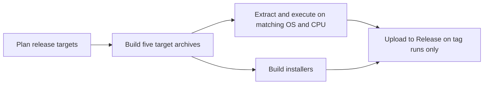

# Compiler archive smoke tests

[日本語](README.md)

Compiler archives for GitHub Releases are built with cargo-dist 0.32.0. Pull requests also build these archives and run a short program using the extracted `cerune` executable.

## Execution order



`pr-run-mode = "upload"` in `dist-workspace.toml` enables archive builds on pull requests. The smoke workflow registered through `global-artifacts-jobs` consumes files uploaded by those build jobs. On tag runs, `host` proceeds with publication after the smoke tests succeed.

| Trigger | Artifact destination |
| --- | --- |
| Pull request creation or update | GitHub Actions artifacts |
| Version tag push | GitHub Release after successful tests |

## Execution hosts

| Target | Runner | Format |
| --- | --- | --- |
| `x86_64-pc-windows-msvc` | `windows-2022` | zip |
| `x86_64-unknown-linux-gnu` | `ubuntu-22.04` | tar.xz |
| `aarch64-unknown-linux-gnu` | `ubuntu-22.04-arm` | tar.xz |
| `x86_64-apple-darwin` | `macos-15-intel` | tar.xz |
| `aarch64-apple-darwin` | `macos-15` | tar.xz |

The script requires all five targets in the plan and checks their runner mappings. It also checks the executing OS and CPU. macOS Intel archives run directly on Intel runners, and ARM archives on ARM runners. The table describes CI test environments. The Windows candidate archive also passed startup/execution on Windows 11 Home 10.0.26100 ([test record and publication steps](../release-readiness.en.md)). Minimum supported OS versions will be established during publication preparation.

## Success criteria

1. Select exactly one Cerune archive for the target from the plan. Missing or ambiguous candidates fail.
2. Verify archive bytes against the SHA-256 file produced by the same build.
3. Extract into a new directory outside the checkout. Windows uses the system tar even when launched through Git Bash.
4. Run the extracted executable with `--help` and confirm the Cerune version recorded in the plan.
5. Write `print(7);` to a file and execute it with `cerune run`, requiring exit code 0, stdout `7\n` and empty stderr.

Compiler commands execute with an empty PATH using the absolute path of the extracted executable. Each command has a 60-second timeout. `observations.json` records the archive name, SHA-256, commands, status, stdout and stderr. Missing or damaged artifacts produce a recorded failure.

## Local execution

Rust follows the repository's `rust-toolchain.toml`. Install cargo-dist 0.32.0, Node.js 24 and tar, then run from the repository. This example targets Windows x64.

```text
dist build --artifacts=local --target=x86_64-pc-windows-msvc
node -e "require('fs').writeFileSync('compiler-plan.json',require('child_process').execFileSync('dist',['plan','--output-format=json']))"
node scripts/compiler-archive-smoke.cjs compiler-plan.json x86_64-pc-windows-msvc target/distrib C:/Temp/cerune-compiler-smoke
```

The final argument names a new directory to create. On Linux/macOS, choose the matching target from the table and change the output path. If output placement changes, inspect `upload_files` from `dist build --output-format=json` and pass the directory containing the archives.

To change the Release workflow, edit cargo-dist configuration and run `dist generate`. Also require `dist generate --check` to pass. Follow the [runtime bundle instructions](../process-runtime/README.en.md) to build subprocess runtime candidates.
