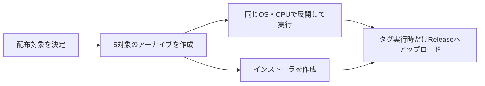

# コンパイラ配布物の起動試験

[English](README.en.md)

GitHub Releaseに載せるコンパイラは、cargo-dist 0.32.0で作成します。PRでも同じアーカイブを作り、展開した `cerune` で短いプログラムを実行します。

## 実行する順序



`dist-workspace.toml` の `pr-run-mode = "upload"` によって、PRでもアーカイブ作成まで実行します。`global-artifacts-jobs` に指定した起動試験は、ビルドジョブがアップロードしたファイルを受け取ります。`host` はその試験に依存するため、失敗した配布物を公開しません。PRの実行ではReleaseへアップロードしません。

## 各アーカイブを実行する場所

| target | runner | 形式 |
| --- | --- | --- |
| `x86_64-pc-windows-msvc` | `windows-2022` | zip |
| `x86_64-unknown-linux-gnu` | `ubuntu-22.04` | tar.xz |
| `aarch64-unknown-linux-gnu` | `ubuntu-22.04-arm` | tar.xz |
| `x86_64-apple-darwin` | `macos-15-intel` | tar.xz |
| `aarch64-apple-darwin` | `macos-15` | tar.xz |

5対象を省略せずに実行します。試験スクリプトはplanにある対象数、runner、CPUを確認します。macOSのIntel版はIntel runner、ARM版はARM runnerで動かします。RosettaやQEMUには依存しません。この表はCIで試す環境を示しており、動作するOSの最低版を定めるものではありません。

## 成功と判断する条件

1. planから該当targetのCeruneアーカイブを1個選ぶ。存在しない場合や複数候補がある場合は失敗する。
2. 同じビルドで作ったSHA-256ファイルを読み、アーカイブの内容を照合する。
3. checkout外の新規ディレクトリへ展開する。WindowsではGit Bashから起動してもOS付属のtarを使う。
4. 展開した実行ファイルに `--help` を渡し、planに記録されたCerune版が表示されることを確認する。
5. `print(7);` を書いたファイルを `cerune run` で実行し、終了コード0、標準出力 `7\n`、空の標準エラーを確認する。

コンパイラの実行時はPATHを空にします。リポジトリ内でビルドした別の `cerune` を探す処理はありません。各コマンドには60秒の上限を設け、アーカイブ名・SHA-256・実行コマンド・終了状態・標準出力・標準エラーを `observations.json` に保存します。欠落や破損を検出したら、その理由を記録して失敗します。

## 手元で試す

Rustの版はリポジトリの `rust-toolchain.toml` に従います。cargo-dist 0.32.0、Node.js 24、tarを用意し、リポジトリ内で実行してください。以下はWindows x64の例です。

```text
dist build --artifacts=local --target=x86_64-pc-windows-msvc
node -e "require('fs').writeFileSync('compiler-plan.json',require('child_process').execFileSync('dist',['plan','--output-format=json']))"
node scripts/compiler-archive-smoke.cjs compiler-plan.json x86_64-pc-windows-msvc target/distrib C:/Temp/cerune-compiler-smoke
```

最後の出力先はまだ存在しないディレクトリを指定します。Linux/macOSでは、表から実行環境に合うtargetを選び、出力先も変更してください。保存先を変更した場合は、`dist build --output-format=json` が出力する `upload_files` でアーカイブの場所を確認し、そのディレクトリを渡します。

Releaseワークフローを変更するときは、cargo-distの設定を編集して `dist generate` を実行します。`dist generate --check` が成功することも確認します。子プロセス用runtimeの配布候補は[専用の説明](../process-runtime/README.md)に従って作成してください。
